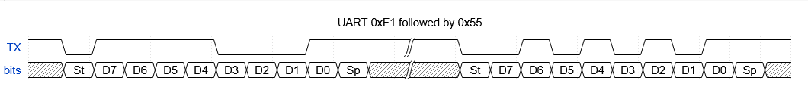
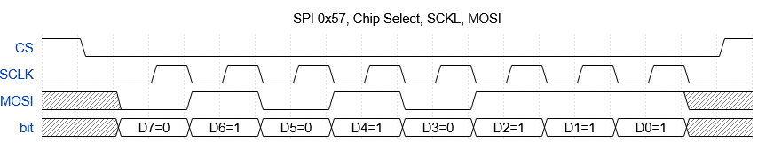

# ECE 528/L – Homework 3

**Name:** Jamal Bhola  
**Course:** ECE 528/L – Robotics and Embedded Systems with Lab  
**Semester:** Fall 2026


---

## Section I: Review Questions

### Question 1 (10 pts)

_The MSP432 uses the eUSCI_A modules for UART communication. Describe the function of the following registers:_

| Register | Function |
|----------|----------|
| `UCAxBRW` (Baud Rate Control Word) | 16-bit clock prescaler (UCBRx). It divides the selected clock (BRCLK) to make the bit clock: `BRW = INT(f_BRCLK / baud)` when UCOS16 = 0, or `INT(f_BRCLK / (16 * baud))` when UCOS16 = 1 (oversampling). |
| `UCAxMCTLW` (Modulation Control Word) | Fine-tunes the baud rate when f_BRCLK is not a whole multiple of the baud rate. It holds the oversampling enable (UCOS16, bit 0, `0x0001`), the first-stage modulation pattern (UCBRFx, bits 7-4, `0x00F0`) and the second-stage modulation pattern (UCBRSx, bits 15-8, `0xFF00`). These adjust individual bit timings so the average rate is closer to the target. |
| `UCAxCTLW0` (Control Word 0) | Main configuration register. It sets parity enable/select (UCPEN `0x8000`, UCPAR `0x4000`), bit order (UCMSB `0x2000`), 7/8-bit data (UC7BIT `0x1000`), 1/2 stop bits (UCSPB `0x0800`), mode (UCMODEx `0x0600`), sync/async (UCSYNC `0x0100`) and clock source (UCSSELx `0x00C0`). It also has the RX-error/break interrupt enables, dormant/address bits, and the software reset UCSWRST (`0x0001`). UCSWRST must be 1 while the module is being configured. |
| `UCAxRXBUF` (Receive Buffer) | Holds the last full character moved in from the receive shift register (bits 7-0 are UCRXBUFx). Reading it clears the UCRXIFG flag and the receive error flags (UCRXERR, UCFE, UCPE, UCOE, UCBRK). It is read-only. |
| `UCAxTXBUF` (Transmit Buffer) | Holds the next character to send. The hardware moves it into the transmit shift register, and it is shifted out on UCAxTXD. Writing it clears UCTXIFG. Software should wait for UCTXIFG = 1 (buffer empty) before writing the next byte. |

---

### Question 2 (5 pts)

_What is the purpose of the UCAxSTATW status register in the UART module? Which bits indicate the following?_

**Purpose:** UCAxSTATW reports the state of the eUSCI_A module: busy, receive errors (framing, parity, overrun, break), address/idle detection, and loopback (UCLISTEN). Software reads it to check whether a transfer is still in progress and whether the received data is valid. The error flags clear when UCAxRXBUF is read.

| Condition | Bit(s) | Mask |
|-----------|--------|------|
| UART module is currently transmitting | UCBUSY (bit 0): 1 = a transmit or receive operation is in progress | `0x0001` |
| Framing, parity, or overrun error occurred | UCRXERR (bit 2): summary receive-error flag. The individual flags are UCPE (bit 4, `0x0010`, parity), UCOE (bit 5, `0x0020`, overrun) and UCFE (bit 6, `0x0040`, framing). | `0x0004` (summary), `0x0070` (UCFE \| UCOE \| UCPE) |
| RX buffer contains unread data | UCRXIFG (bit 0 of **UCAxIFG**, not UCAxSTATW): set when UCAxRXBUF has a new character, cleared when RXBUF is read. In STATW, UCOE (`0x0020`) shows that an unread character was overwritten. | `0x0001` (in UCAxIFG) |

---

### Question 3 (5 pts)

_Assume that the eUSCI_A3 module is using SMCLK as its clock source, which has a frequency of 12 MHz. Calculate the value that is needed to be written to the UCAxBRW register to configure the eUSCI_A3 module for 115200 baud._

**Work:**

```
N = f_BRCLK / Baud Rate = 12,000,000 / 115,200 = 104.1667

UCOS16 = 0 (low-frequency baud rate mode)
UCA3BRW = INT(N) = 104 = 0x0068

Actual baud = 12,000,000 / 104 = 115,384.6 baud  (error ≈ +0.16 %)
```

**Answer:** `UCA3BRW = 104 (0x0068)` with UCOS16 = 0 and the modulation fields in UCA3MCTLW cleared.

_(If oversampling were used instead, UCOS16 = 1: N/16 = 6.51, so UCBRx = 6, UCBRFx = 8, UCBRSx = 0x20, which is the TI-recommended setting from the TRM baud-rate table.)_

---

### Question 4

#### (a) (15 pts)

_Write a function named UART2_Init that configures the eUSCI_A2 module for the following settings:_
- _Baud Rate: 115200_
- _Data Length: 8 bits_
- _Parity: None_
- _Stop Bits: 1_
- _Bit Order: Most Significant Bit (MSB) First_
- _Clock Source: SMCLK (12 MHz)_
- _Pins: P3.2 (UCA2TXD) and P3.3 (UCA2RXD)_

```c
#include "msp.h"

void UART2_Init(void)
{
    // Hold the eUSCI_A2 module in reset while it is being configured
    EUSCI_A2->CTLW0 |= 0x0001;              // UCSWRST = 1

    // Configure UCA2CTLW0
    // bit 15    UCPEN   = 0  parity disabled
    // bit 14    UCPAR   = 0  (don't care, parity disabled)
    // bit 13    UCMSB   = 1  MSB first
    // bit 12    UC7BIT  = 0  8-bit data
    // bit 11    UCSPB   = 0  one stop bit
    // bits 10-9 UCMODEx = 00 UART mode
    // bit 8     UCSYNC  = 0  asynchronous mode
    // bits 7-6  UCSSELx = 10 SMCLK as BRCLK
    // bit 5     UCRXEIE = 0  erroneous characters rejected
    // bit 4     UCBRKIE = 0  break characters do not set UCRXIFG
    // bit 3     UCDORM  = 0  not dormant
    // bit 2     UCTXADDR= 0  next frame is data
    // bit 1     UCTXBRK = 0  next frame is not a break
    // bit 0     UCSWRST = 1  stay in reset
    EUSCI_A2->CTLW0 = 0x2081;

    // Baud rate: 12,000,000 / 115,200 = 104.17 -> UCBRx = 104 (0x0068)
    EUSCI_A2->BRW = 0x0068;

    // Clear UCBRSx (bits 15-8), UCBRFx (bits 7-4) and UCOS16 (bit 0)
    EUSCI_A2->MCTLW &= ~0xFFF1;

    // P3.2 and P3.3 use the primary module function (SEL1 = 0, SEL0 = 1)
    P3->SEL0 |= 0x0C;
    P3->SEL1 &= ~0x0C;

    // Release the module from reset
    EUSCI_A2->CTLW0 &= ~0x0001;             // UCSWRST = 0

    // Disable interrupts (UCTXCPTIE, UCSTTIE, UCTXIE, UCRXIE); polling is used
    EUSCI_A2->IE &= ~0x000F;
}
```

_Note: The MSP432P401R datasheet maps P3.2 = UCA2RXD and P3.3 = UCA2TXD. The bitmask `0x0C` selects both pins, so the code is the same either way._

#### (b) (10 pts)

_Draw the waveform for the UART TX data line if the main program is transmitting two bytes: 0xF1 followed by 0x55. Clearly label the start bits, data bits, and stop bits. Assume that there is a 50 ms delay between the two bytes._



_Notes:_
- The line idles HIGH. Each frame is: start bit (0), 8 data bits sent MSB first (D7 to D0), no parity, and one stop bit (1). That is 10 bits per frame.
- Bit time = 1 / 115200 ≈ 8.68 µs, so each frame lasts ≈ 86.8 µs. During the 50 ms delay the line stays HIGH (idle). The gap is not drawn to scale.
- `0xF1` = `1111 0001` → frame: `0 | 1 1 1 1 0 0 0 1 | 1`
- `0x55` = `0101 0101` → frame: `0 | 0 1 0 1 0 1 0 1 | 1`


---

### Question 5 (5 pts)

_What is the function of the eUSCI_B module? How does SPI communication differ from UART communication in terms of:_

**Function of eUSCI_B:** The eUSCI_B (enhanced Universal Serial Communication Interface, type B) is a serial peripheral that supports **SPI** (3-pin or 4-pin, controller or peripheral) and **I²C** modes. The MSP432 uses it to talk to synchronous peripherals such as displays, sensors, memory, and ADC/DAC chips. It handles the shift registers, bit-clock generation (UCBxBRW), and TX/RX buffers and interrupt flags. Unlike eUSCI_A, it has no UART mode.

| Aspect | SPI | UART |
|--------|-----|------|
| Synchronization | Synchronous. Both sides use the shared SCLK, so every bit is sampled on a known clock edge. | Asynchronous. There is no shared clock. The receiver resynchronizes on the falling edge of each start bit and samples mid-bit (with oversampling). |
| Clocking | The controller (MSP432) generates SCLK. Its rate is set by the controller (f_BRCLK / UCBxBRW) and can change freely. Peripherals use the controller's clock. | Each device uses its own local clock. Both must be set to the same baud rate in advance (within about ±2 to 5 % error). |
| Signaling | 3 or 4 wires: SCLK, MOSI, MISO, plus CS (one per peripheral). It is full-duplex and controller/peripheral, with many peripherals on one bus. | 2 data wires: TX and RX (crossed between devices). It is full-duplex and point-to-point. The line idles HIGH. |
| Data Framing | No start, stop, or parity bits. A transfer is framed by CS being asserted and by the number of clock pulses (7 or 8 bits per character on the MSP432). Data shifts out and in at the same time. | Each character is framed by a start bit (0), 7 or 8 data bits (LSB or MSB first), an optional parity bit, and 1 or 2 stop bits (1). |

---

### Question 6

#### (a) (5 pts)

_Explain the role of the following SPI signals:_

| Signal | Role |
|--------|------|
| SCLK | Serial clock, generated only by the controller. Each clock cycle shifts one bit in both directions. CPOL/CPHA (UCCKPL/UCCKPH) set its idle level and which edge captures data versus which edge changes it. |
| CS | Chip Select (usually active low, also called STE/SS). It is driven by the controller to pick which peripheral takes part in the transfer. When CS is deasserted (HIGH), the peripheral ignores SCLK/MOSI and tri-states its MISO output. CS also marks the start and end of a transaction. |
| MISO | Controller In, Peripheral Out (UCBxSOMI). It carries data from the selected peripheral to the controller. Only the selected peripheral drives it. |
| MOSI | Controller Out, Peripheral In (UCBxSIMO). It carries data from the controller to the peripheral(s). It is shifted out of UCBxTXBUF MSB or LSB first. |

#### (b) (5 pts)

_What happens if multiple SPI peripheral devices have their CS line asserted simultaneously on the MSP432?_

All selected peripherals see the same SCLK and MOSI data, so each one accepts the same command or data. That can cause unwanted writes or configuration changes. Worse, **every selected peripheral drives MISO at the same time**. That causes bus contention: outputs push-pull against each other, the logic levels become undefined, and the MSP432 reads corrupted data. The large currents can also damage the output drivers. The eUSCI_B has no arbitration in SPI mode and does not detect this. Firmware must drive the CS GPIOs so that **only one CS is active at a time**. (The exception is a daisy-chain design, where devices are wired in series so that only one MISO reaches the controller, or write-only peripherals that do not drive MISO.)

---

### Question 7

#### (a) (5 pts)

_Briefly describe the function of the UCBxCTLW0 (Control Word 0) register from the eUSCI_B module._

UCBxCTLW0 is the main 16-bit control register for eUSCI_B. In SPI mode it selects:
- clock phase (UCCKPH) and polarity (UCCKPL), which set the SPI mode
- bit order (UCMSB) and character length (UC7BIT)
- controller/peripheral role (UCMST)
- mode (UCMODEx: 3-pin SPI, 4-pin SPI with STE active high or low, or I²C)
- synchronous operation (UCSYNC)
- clock source (UCSSELx)
- STE pin function (UCSTEM)
- software reset (UCSWRST)

UCSWRST (`0x0001`) must be set before changing the other bits and cleared to start the module. In I²C mode the same register holds the I²C-specific bits instead (addressing mode, transmitter/receiver, start/stop generation, etc.).

#### (b) (5 pts)

_Which bits need to be cleared or set in the UCBxCTLW0 register to configure the SPI mode used by the eUSCI_B module? Provide a description of each bit._

The SPI mode (0 to 3) is set by the clock phase and clock polarity bits:

| Bit | Name | Mask | Description |
|-----|------|------|-------------|
| 15 | UCCKPH (clock phase) | `0x8000` | 0 = data is changed on the first UCLK edge and captured on the following edge. 1 = data is captured on the first UCLK edge and changed on the following edge. |
| 14 | UCCKPL (clock polarity) | `0x4000` | 0 = inactive (idle) clock state is LOW. 1 = inactive (idle) clock state is HIGH. |

Mapping to the standard SPI modes. Note that MSP432 UCCKPH is the **inverse** of standard CPHA:

| SPI Mode | CPOL | CPHA | UCCKPL | UCCKPH | CTLW0 bits |
|----------|------|------|--------|--------|------------|
| 0 | 0 | 0 | 0 | 1 | `0x8000` |
| 1 | 0 | 1 | 0 | 0 | `0x0000` |
| 2 | 1 | 0 | 1 | 1 | `0xC000` |
| 3 | 1 | 1 | 1 | 0 | `0x4000` |

Bits that put the module in SPI (rather than I²C) mode:

| Bit | Name | Mask | Description |
|-----|------|------|-------------|
| 8 | UCSYNC | `0x0100` | Must be 1 (synchronous mode) for SPI. |
| 10-9 | UCMODEx | `0x0600` | 00 = 3-pin SPI. 01 = 4-pin SPI, STE active high. 10 = 4-pin SPI, STE active low. 11 = I²C (not SPI). |

#### (c) (5 pts)

_Which field in the UCBxCTLW0 register selects the clock source used by the eUSCI_B module? Provide the values used and the corresponding clock sources._

**Field:** UCSSELx (bits 7-6, mask `0x00C0`). It selects the BRCLK source in controller (master) mode. In peripheral (slave) mode the external UCxCLK pin is always used.

| Value | Clock Source |
|-------|--------------|
| `0x0000` | Reserved (UCSSELx = 00b; in peripheral mode the external UCxCLK is used) |
| `0x0040` | ACLK (UCSSELx = 01b) |
| `0x0080` | SMCLK (UCSSELx = 10b) |
| `0x00C0` | SMCLK (UCSSELx = 11b) |

---

### Question 8

#### (a) (15 pts)

_Write a function named EUSCI_B0_SPI_Init that configures the eUSCI_B0 module for SPI communication with the following settings:_
- _SPI Mode: 0_
- _Data Length: 8 bits_
- _Bit Order: Most Significant Bit (MSB) First_
- _Clock Source: SMCLK (12 MHz)_
- _SPI Clock Frequency: 1 MHz_
- _SPI format: 3-wire SPI_
- _SPI Pins:_
  - _P1.5: SCLK (UCB0CLK)_
  - _P1.6: MOSI (UCB0SIMO)_
  - _P1.7: MISO (UCB0SOMI)_
  - _P9.0: Active Low Chip Select (GPIO)_

```c
#include "msp.h"

void EUSCI_B0_SPI_Init(void)
{
    // Hold the eUSCI_B0 module in reset while it is being configured
    EUSCI_B0->CTLW0 |= 0x0001;              // UCSWRST = 1

    // Configure UCB0CTLW0
    // bit 15    UCCKPH  = 1  data captured on first edge, changed on next (Mode 0)
    // bit 14    UCCKPL  = 0  clock idles LOW (Mode 0)
    // bit 13    UCMSB   = 1  MSB first
    // bit 12    UC7BIT  = 0  8-bit data
    // bit 11    UCMST   = 1  controller (master) mode
    // bits 10-9 UCMODEx = 00 3-pin SPI
    // bit 8     UCSYNC  = 1  synchronous mode
    // bits 7-6  UCSSELx = 10 SMCLK as BRCLK
    // bits 5-2  reserved = 0
    // bit 1     UCSTEM  = 0  (STE unused in 3-pin mode)
    // bit 0     UCSWRST = 1  stay in reset
    EUSCI_B0->CTLW0 = 0xA981;

    // SPI clock: f_BitClock = f_BRCLK / UCBRx = 12 MHz / 12 = 1 MHz
    EUSCI_B0->BRW = 0x000C;

    // P1.5 (UCB0CLK), P1.6 (UCB0SIMO), P1.7 (UCB0SOMI) use the primary module function
    P1->SEL0 |= 0xE0;
    P1->SEL1 &= ~0xE0;

    // P9.0 = GPIO output used as active-low chip select, start deasserted (HIGH)
    P9->SEL0 &= ~0x01;
    P9->SEL1 &= ~0x01;
    P9->OUT  |= 0x01;
    P9->DIR  |= 0x01;

    // Release the module from reset
    EUSCI_B0->CTLW0 &= ~0x0001;             // UCSWRST = 0

    // Disable interrupts (UCTXIE, UCRXIE); polling is used
    EUSCI_B0->IE &= ~0x0003;
}
```

#### (b) (10 pts)

_If a main program transmits one byte with a value of 0x57, draw the waveforms for: Chip Select (Active Low), SCLK, MOSI._



_Notes:_
- `0x57` = `0101 0111`, sent MSB first: D7..D0 = `0 1 0 1 0 1 1 1`.
- SPI Mode 0 (CPOL = 0, CPHA = 0): SCLK idles LOW. MOSI holds D7 before the first rising edge. The peripheral samples MOSI on each **rising** edge, and the MSP432 changes MOSI on each **falling** edge.
- SCLK = 1 MHz, so each bit takes 1 µs and the byte takes 8 µs (8 clock pulses).
- CS (P9.0) is pulled LOW by software before the byte is written to UCB0TXBUF. It goes back HIGH after UCBUSY clears (transfer complete).


---

## References

- MSP432P4xx SimpleLink Microcontrollers Technical Reference Manual (SLAU356)
- MSP432P401R Datasheet (SLAS826)
